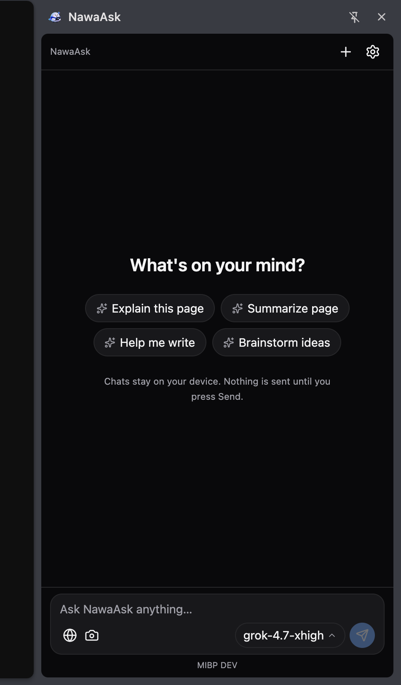

# NawaAsk — Your AI, Anywhere on the Web



Lightweight Chrome (MV3) AI assistant. Chat in the side panel, ask about selected
text with a floating Ask NawaAsk pill, drag-select a region of the page to screenshot,
summarize pages, and connect any OpenAI-compatible provider. Built with Bun +
WXT + Preact + TypeScript. No React.

## Quick start

```bash
bun install
bun run dev        # loads unpacked extension, hot reload
```

Production:

```bash
bun run build      # output in .output/chrome-mv3/
```

Load in Chrome: `chrome://extensions` → Developer mode → Load unpacked →
select `.output/chrome-mv3/`.

Other commands: `bun run compile` (typecheck), `bun run zip` (store package).

## Optional cloud backend (Hono + Cloudflare Workers)

The extension works fully without it (BYOK default). The backend currently
exposes only `GET /health`, `GET /api/v1/health`, `GET /api/v1/meta` —
all cloud features are capability-flagged off.

```bash
cd backend
bun install
bun test            # 8 unit tests
bun run dev         # wrangler dev → http://localhost:8787
bun run deploy      # wrangler deploy
```

Point a build at it (empty = BYOK-only):

```bash
VITE_NAWAASK_CLOUD_API_BASE_URL=https://<worker> bun run build
```

Details: `docs/ARCHITECTURE.md`, `docs/CLOUD_ARCHITECTURE.md`,
`docs/DEPLOYMENT_CLOUDFLARE.md`, `docs/PRIVACY.md`, `docs/SECURITY.md`,
`docs/RELEASE.md`.

## Configure a provider

Options page → Providers, or sidepanel → gear icon. Only custom providers
exist — no built-in presets. Click **New custom**, then per card:

- **Protocol**: **OpenAI Compatible** or **Anthropic Compatible**
  (`POST {base}/messages`, `x-api-key` + `anthropic-version: 2023-06-01`).
- **API** (OpenAI protocol only): **Chat Completions**
  (`POST {base}/chat/completions`, SSE with `[DONE]`) or **Responses**
  (`POST {base}/responses`, `response.output_text.delta` events).
- **Base URL** (include `/v1` where required) and **API key**.
- **Test connection**, then **Fetch from API** for `/models` (or add a model
  ID manually). Click a model chip to set the default.

Chat, model fetch, and connection tests follow the protocol and API on each card.

### Provider notes

- **Ollama** runs at `http://localhost:11434/v1` (placeholder key `ollama`).
  Chrome may block `localhost` subresources from `chrome-extension://` pages;
  if Test fails, run Chrome with `--allow-insecure-localhost` or use a tunnel.
- **Qwen (DashScope)** uses `/compatible-mode/v1`, which speaks OpenAI protocol.
- **OpenRouter** may require `HTTP-Referer`/`X-Title` headers for some keys;
  not sent by default — add a Custom provider entry if needed.

## Features

- Side-panel chat: streaming markdown + code highlight, copy, regenerate, stop,
  auto-scroll, model switcher.
- Select text → floating **Ask NawaAsk** pill attaches the selection to the
  composer as a removable context card (source title + URL). Nothing is sent
  until you type a question and press Send. Selecting text never calls the AI.
- Screenshot → camera button opens a drag-to-select overlay on the page; the
  selected region is captured, downscaled to a removable preview card, and
  sent with your question to a vision-capable model. Capture happens only on
  click; nothing leaves the browser until Send.
- `Ctrl+Shift+K` / `Cmd+Shift+K` opens the panel.
- Toolbar icon click opens the side panel directly (no popup).
- History: IndexedDB persistence, search, pin, rename, export `.md`.
- Prompt library: 11 built-ins + custom templates
  (`{{selection}}`, `{{title}}`, `{{url}}`, `{{page}}`).
- Themes: light / dark / system.

## Privacy

- API keys live in `chrome.storage.local` on this device only, sent only to the
  configured provider base URL. Chrome storage is **not encrypted** — anyone
  with profile access can read it.
- Page content is extracted only on explicit action (Ask pill click, page
  attach, "summarize this page"). Page text is treated as untrusted data:
  system prompt instructs the model not to follow instructions inside it.
- Screenshots are captured only when you click the camera button and drag a
  region on the page: the selected region is downscaled to JPEG and kept in
  the composer until you press Send. It is then sent to the configured
  provider and stored with the local conversation. No screenshot is ever
  captured in the background.
- Content scripts never see keys; keys never touch page DOM.

## Project layout

```
entrypoints/  background.ts (side panel, selection relay, commands)
              content.ts (Ask NawaAsk pill, page extraction)
              sidepanel/ options/
components/   chat/ sidebar/ providers/ history/ options/ settings/ ui/
composables/  useChat / useProviders / useSettings / usePrompts /
              useView / useModelSelector (Preact signals)
modules/      ai/ (client, streaming SSE, protocol, types)
              browser/ (messaging types, page-context, screenshot capture)
              storage/ (settings, providers, IndexedDB conversations)
              prompts/ (templates, system prompts)
utils/        markdown (marked+DOMPurify+highlight.js), errors, constants
```

Content script is dependency-free DOM code (no Preact) to stay light.

## Known limitations

- `highlight.js/lib/common` (~40 languages) dominates the sidepanel bundle
  (~250 KB). Swap for a smaller subset if size matters.
- Rename uses a native `prompt()` dialog (functional MVP).
- Screenshots cover only the region you drag (within the visible viewport) and
  require a vision-capable model on the configured provider.
- Firefox: `bun run build:firefox`; sidePanel API needs Firefox 142+.
